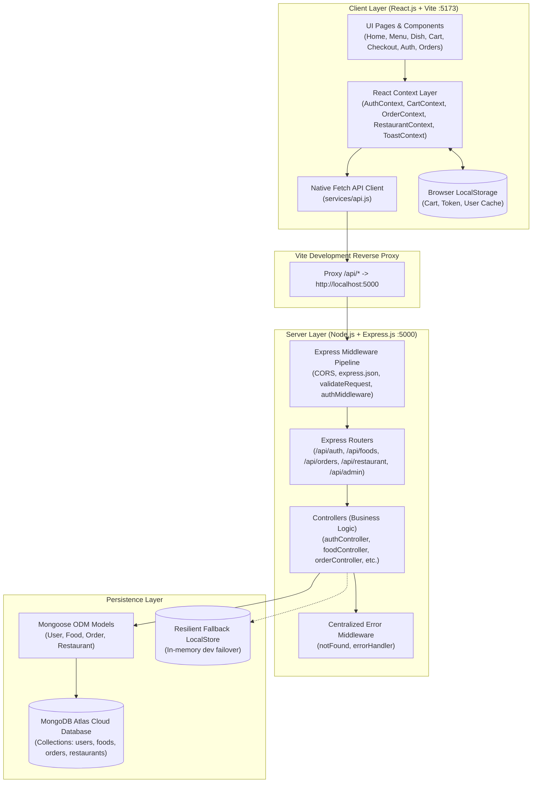
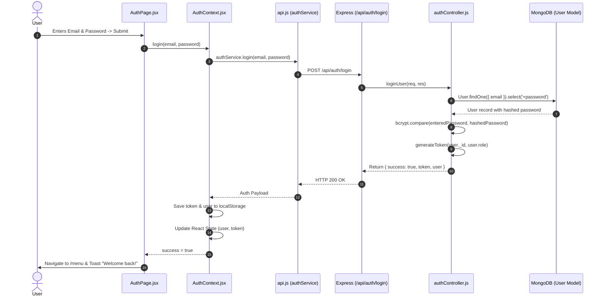
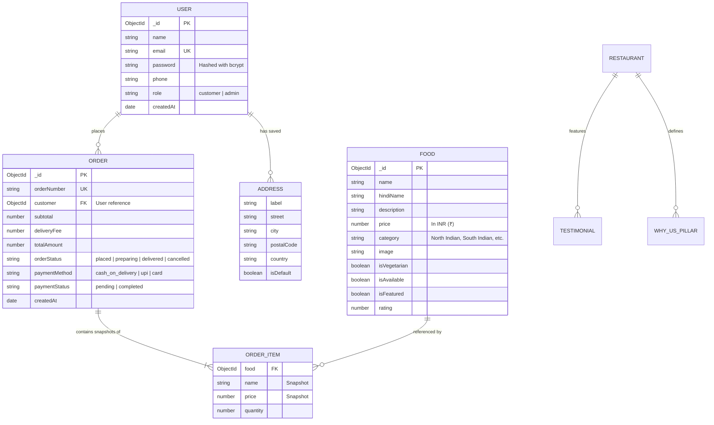

# The Indian Rasoi — Comprehensive Viva Examination Study Guide
**MERN Stack Gourmet Food Delivery Platform**

---

## 1. 30-Second Elevator Pitch (Start Your Viva With This)
> *"The Indian Rasoi is a full-stack MERN food delivery web application designed for an authentic Indian fine-dining and delivery experience in Indian Rupees (₹). It features an Express/Node.js REST API with Mongoose ODM connected to MongoDB Atlas, and a responsive React single-page frontend bundled with Vite and styled using Tailwind CSS. It implements secure JWT-based stateless authentication, server-validated shopping carts with snapshot preservation against price manipulation, dynamic menu querying with multi-criteria filtering, and a resilient fail-fast database architecture that avoids query buffering timeouts."*

---

## 2. Complete Technology Stack & Why It Was Chosen

| Layer | Technology | Version / Tooling | Why It Was Chosen (Viva Answer) |
| :--- | :--- | :--- | :--- |
| **Frontend UI** | **React.js** | React 19 (Hooks, Suspense, Lazy) | Component-based reusability, virtual DOM performance, and unidirectional state management. |
| **Build & Dev Tool** | **Vite** | Vite 8.3 | Ultra-fast Hot Module Replacement (HMR) based on native ES Modules, zero cold-start delay, built-in `/api` proxy. |
| **Styling & Design** | **Tailwind CSS v4** | `@tailwindcss/vite` | Utility-first CSS for fast prototyping, custom luxury color palette (`#0d0c0c` dark theme, `#d4af37` gold accents), zero dead CSS chunks. |
| **Typography** | **Google Fonts** | Inter & Playfair Display | **Playfair Display** (refined serif) for royal branding & headings; **Inter** (modern sans-serif) for readable body text, buttons, and forms. |
| **Routing** | **React Router DOM** | v7 | Declarative client-side routing, URL search params synchronization (`useSearchParams`), code splitting via `React.lazy`. |
| **Icons** | **Lucide React** | Modern SVG icons | Lightweight tree-shakable SVG icon set matching the minimalist luxury restaurant aesthetic. |
| **Backend Runtime**| **Node.js** | v20+ LTS | Event-driven, non-blocking I/O runtime well-suited for I/O-intensive REST APIs and concurrent HTTP traffic. |
| **Web Framework** | **Express.js** | v5 | Minimalist and unopinionated framework providing robust routing, middleware pipelines, and centralized error handling. |
| **Database** | **MongoDB Atlas** | MongoDB 7+ (Cloud / Local) | Flexible NoSQL document model ideally suited for nested structures like menu items, order line snapshots, and addresses. |
| **ODM Layer** | **Mongoose** | v9 | Schema validation, type casting, pre-save middleware hooks (bcrypt hashing), and query helpers. |
| **Security & Auth** | **JWT & Bcrypt.js** | `jsonwebtoken` + `bcryptjs` | Stateless authentication using signed JSON Web Tokens (Bearer auth) and one-way salted password hashing (10 salt rounds). |

---

## 3. High-Level System Architecture

---

## 4. What is Connected With What? (Core Application Flows)

### Flow 1: Authentication & User Session Lifecycle

### Flow 2: Cart Integrity, ID Resolution & Checkout Flow
* **The Problem:** Never trust client-submitted prices or stale food IDs from `localStorage`.
* **The Solution:**
  1. The user adds dishes to their cart; the dish `_id`, name, and quantity are kept in `CartContext` and mirrored to `localStorage`.
  2. On cart initialization, `revalidateCart()` calls `POST /api/foods/validate-cart` to verify that all IDs exist in the active database.
  3. During **Checkout (`POST /api/orders`)**, `orderController.js` re-fetches each food item directly from MongoDB by its `_id`.
  4. The backend recalculates the subtotal, taxes, delivery fee, and packaging fee **server-side**.
  5. The order document stores a **snapshot** (`name`, `price`, `image`) of the dish at that exact second, protecting future receipts from subsequent menu price changes.

### Flow 3: Dynamic Menu Discovery & Filtering
* `MenuPage.jsx` reads query parameters directly from the browser URL via `useSearchParams()` (`?category=North+Indian&search=Paneer`).
* Calls `foodService.getAllFoods(params)`, translating state into `GET /api/foods?category=North+Indian&search=Paneer&page=1&limit=12`.
* In `foodController.js`, a dynamic Mongoose query object is constructed:
  - Regex search: `{ $or: [{ name: { $regex: search, $options: 'i' } }, { description: ... }] }`
  - Category match: `{ category }`
  - Vegetarian filter: `{ isVegetarian: true }`
  - Sorting: `.sort({ price: 1 })` or `.sort({ rating: -1 })`

---

## 5. Important Project Files & Their Specific Roles

### Backend Files (`server/`)

| File Path | Primary Role & Viva Explanation |
| :--- | :--- |
| `server/server.js` | **Entry Point:** Initializes Express, configures CORS, body parsers (`express.json`), mounts modular routers, centralized error middleware, and health check endpoint (`/api/health`). |
| `server/config/db.js` | **Database Connection Manager:** Establishes connection to MongoDB Atlas with `bufferCommands: false` (fail-fast architecture), masked URI logging, lifecycle event listeners, and auto-seeding triggers. |
| `server/models/User.js` | **User Schema:** Mongoose schema defining customer and admin roles, address array subdocuments, pre-save hook for `bcrypt` hashing, and `comparePassword()` helper method. |
| `server/models/Food.js` | **Food Schema:** Validates dishes with category enums (`North Indian`, `South Indian`, `Breads`, `Rice & Biryani`, etc.), prices in INR, spice level, calories, dietary tags, and availability flags. |
| `server/models/Order.js` | **Order Schema:** Stores order snapshots (dish name, unit price at purchase, quantity, delivery address), pricing breakdown, payment status, and order status state machine (`placed` $\rightarrow$ `delivered`). |
| `server/models/Restaurant.js` | **Restaurant Profile Schema:** Holds dynamic brand metadata, story, chef quotes, coordinates, hours, delivery fee tiers, why-us philosophy pillars, and customer testimonials. |
| `server/controllers/authController.js` | **Auth Business Logic:** Registration, login, profile fetch, and delivery address CRUD. Dual-mode architecture (MongoDB Atlas + resilient fallback). |
| `server/controllers/foodController.js` | **Menu Business Logic:** Dynamic querying with pagination, category filtering, search, and the `validateCartItems` resolver. |
| `server/controllers/orderController.js` | **Order Business Logic:** Verifies stock and pricing from DB, creates immutable line-item snapshots, calculates delivery fee logic, handles cancellation rules. |
| `server/middleware/authMiddleware.js` | **JWT Verification:** Extracts `Bearer <token>` from HTTP headers, verifies cryptographic signature using `JWT_SECRET`, and attaches decoded user to `req.user`. |
| `server/middleware/errorMiddleware.js` | **Error Interceptor:** Centralized 404 handler and 500/503 error formatting, catching Mongoose CastErrors, duplicate key codes (11000), and validation errors. |

---

### Frontend Files (`client/`)

| File Path | Primary Role & Viva Explanation |
| :--- | :--- |
| `client/src/App.jsx` | **Root Router:** Composes global providers (`Toast`, `Restaurant`, `Auth`, `Cart`, `Order`), renders `Navbar`, `Footer`, lazy-loaded page routes, and global drawers. |
| `client/src/services/api.js` | **Central HTTP Service:** Native fetch wrapper handling JWT header injection (`Authorization: Bearer <token>`), query parameter serialization, and error parsing. |
| `client/src/context/AuthContext.jsx` | **Auth State Management:** Maintains `user`, `token`, and `isLoading`. Syncs session with `localStorage`, validates profile against backend on mount. |
| `client/src/context/CartContext.jsx` | **Cart State Management:** Manages dish basket, quantity steppers, promo codes (`RASOI10`), free delivery threshold calculation (₹499), and cart revalidation. |
| `client/src/context/OrderContext.jsx` | **Order State Management:** Handles order placement, fetching customer order history, live order tracking, and order cancellation. |
| `client/src/context/ToastContext.jsx` | **Toast Feedback:** Deduplicated notification system providing floating status messages (`success`, `error`, `info`). |
| `client/src/pages/MenuPage.jsx` | **Dynamic Menu Browser:** Dynamic category tabs, search input, vegetarian toggles, and responsive food card grid with loading skeletons. |
| `client/src/pages/CheckoutPage.jsx` | **Checkout Terminal:** Address entry / selection, payment method selection, subtotal calculation, delivery fee rules, and order submission. |
| `client/src/pages/AuthPage.jsx` | **Authentication Portal:** Dual mode Login / Registration with client-side regex validation, password confirmation, and demo guest sign-in. |

---

## 6. Database Entity-Relationship (ER) Design

---

## 7. Top 15 Viva Questions & Model Answers

### Q1: What is the MERN stack and why is it suitable for this project?
> **Answer:** MERN stands for **MongoDB, Express.js, React.js, and Node.js**. It enables a unified JavaScript/JSON runtime across both client and server layers. MongoDB handles flexible, document-oriented restaurant menus and order receipts. Node.js and Express handle asynchronous, high-throughput REST API requests with non-blocking I/O. React delivers a responsive single-page application with reusable components and client-side routing.

### Q2: How does authentication work in your application?
> **Answer:** We implement **stateless JWT (JSON Web Token) authentication**.
> 1. When a user registers or logs in, their password is verified using `bcrypt.compare()`.
> 2. The server signs a payload containing the user's `_id` and `role` with a private secret (`JWT_SECRET`) and returns it as a Bearer token.
> 3. The client stores this token in `localStorage` and includes it in the `Authorization: Bearer <token>` header for subsequent requests.
> 4. The `protect` middleware on the server verifies the token signature using `jwt.verify()` and attaches the user document to `req.user`.

### Q3: Why do you hash passwords with bcrypt instead of saving them plain text?
> **Answer:** Storing plain text passwords in a database violates fundamental security standards. If the database were compromised, attacker access would be immediate. `bcrypt` uses a one-way cryptographic hash with an adaptable work factor (we use 10 salt rounds) and automatic per-password salting, which resists rainbow table attacks and brute force cracking.

### Q4: Why is `select: false` set on the password field in the User schema?
> **Answer:** In Mongoose, setting `select: false` on the password attribute ensures that routine database queries (e.g. `User.find()` or `User.findById()`) will never return the hashed password in JSON responses, preventing accidental exposure to the client or log files. We explicitly opt-in with `.select('+password')` only in the authentication controller.

### Q5: How do you prevent price manipulation in the shopping cart?
> **Answer:** We enforce **server-side price validation**. The frontend cart only submits the food IDs and quantities. During checkout (`POST /api/orders`), the backend queries the database for the active prices of those items, recalculates subtotals, applies delivery and packaging fee rules, and constructs the order total server-side. The client's locally modified price is completely ignored.

### Q6: What is an "order item snapshot" and why is it necessary?
> **Answer:** If we only stored the food document ID in an order, then any future price change, menu renaming, or deletion of that dish would corrupt historical order history and receipts. An order item snapshot saves an immutable copy of the product's `name`, `unit price`, and `image` at the exact second of purchase.

### Q7: What was the cause of the "Operation users.findOne() buffering timed out after 10000ms" error?
> **Answer:** By default, Mongoose buffers database operations in memory when disconnected (`bufferCommands: true`), waiting for a connection to be established. If the connection fails or credentials are placeholders, queries hang for 10,000 milliseconds before timing out. We fixed this by setting `mongoose.set('bufferCommands', false)` (fail-fast architecture) and implementing resilient controller fallbacks.

### Q8: What is CORS and how is it addressed in this project?
> **Answer:** CORS (Cross-Origin Resource Sharing) is a browser security mechanism that blocks web pages from making HTTP requests to a different domain, port, or protocol than the one that served the page. We addressed this in two ways:
> 1. Express uses the `cors()` middleware with `allowedOrigins` and `credentials: true`.
> 2. In development, Vite's proxy forwards all `/api` requests from `http://localhost:5173` to `http://localhost:5000` on the server level, making them same-origin in the browser.

### Q9: What is the difference between React Props, State, and Context?
> **Answer:**
> * **Props:** Read-only inputs passed downwards from a parent component to a child.
> * **State:** Local, mutable data managed within a component that triggers a re-render when modified via its setter function.
> * **Context:** Global state accessible by any nested component in the component tree without manual prop drilling (e.g. `AuthContext`, `CartContext`, `ToastContext`).

### Q10: What are Mongoose Middleware / Hooks? Where did you use them?
> **Answer:** Mongoose middleware functions are passed control during execution of asynchronous database operations. We used a **pre-save document middleware** (`userSchema.pre('save')`) in `User.js` to automatically hash the user's password with bcrypt whenever the password field is modified before writing to MongoDB.

### Q11: Explain the MVC architecture as implemented in your backend.
> **Answer:**
> * **Model (`server/models/`):** Defines database schemas and data constraints (`User.js`, `Food.js`, `Order.js`, `Restaurant.js`).
> * **View (`client/`):** The React frontend, presenting UI to the user and capturing user interactions.
> * **Controller (`server/controllers/`):** Encapsulates the business logic, processing incoming HTTP requests, querying the models, and sending JSON responses (`authController.js`, `orderController.js`, etc.). Routes (`server/routes/`) act as the dispatchers routing URLs to controller methods.

### Q12: How is pagination implemented in your food menu?
> **Answer:** In `foodController.js`, we use Mongoose `.skip()` and `.limit()`:
> `skip = (page - 1) * limit`.
> We also run `Food.countDocuments(query)` to calculate `totalPages = Math.ceil(total / limit)`, allowing the frontend to render previous/next navigation and page counts.

### Q13: What happens when a user logs out?
> **Answer:** Because JWT is stateless, logout is executed on the client side:
> 1. The `AuthContext` clears the `user` and `token` state.
> 2. `localStorage.removeItem('indian_rasoi_token')` and `localStorage.removeItem('indian_rasoi_user')` are executed.
> 3. The user is redirected to the home/menu page, and the navbar profile dropdown immediately removes the user's email.

### Q14: How does your frontend maintain responsiveness and performance?
> **Answer:**
> * **Code Splitting:** `React.lazy()` and `<Suspense fallback={<PageLoading />}>` split pages into separate JS chunks, so the browser only loads code for the current view.
> * **Tailwind CSS v4:** Zero unused CSS in production; generates minimal atomic utility classes.
> * **Skeleton Loaders:** Prevents Layout Shift (CLS) while dynamic food data is being fetched.
> * **Modern Font Pairing:** `Inter` and `Playfair Display` preconnected via Google Fonts with `display=swap`.

### Q15: How are admin privileges enforced?
> **Answer:** We implement Role-Based Access Control (RBAC). In `authMiddleware.js`, the `admin` middleware checks `if (req.user && req.user.role === 'admin') next() else res.status(403)`. Protected admin endpoints (like creating or deleting menu items or reviewing all platform orders) require both `protect` and `admin` middlewares.
